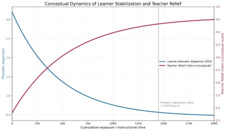
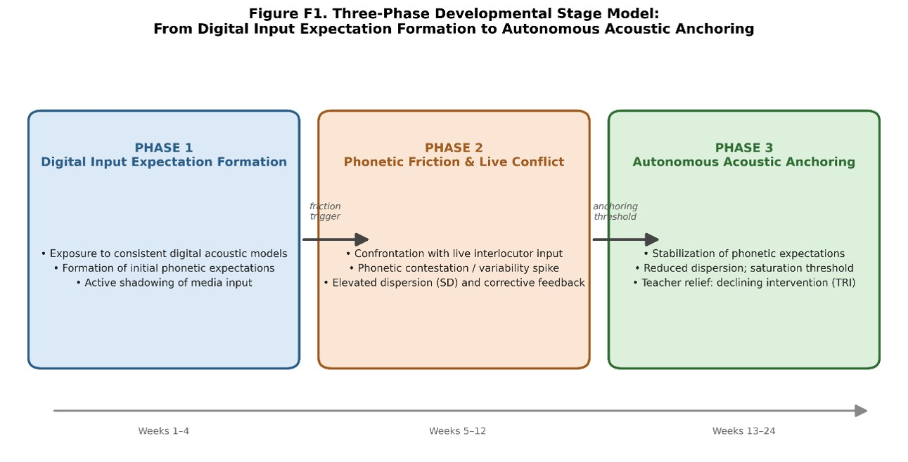
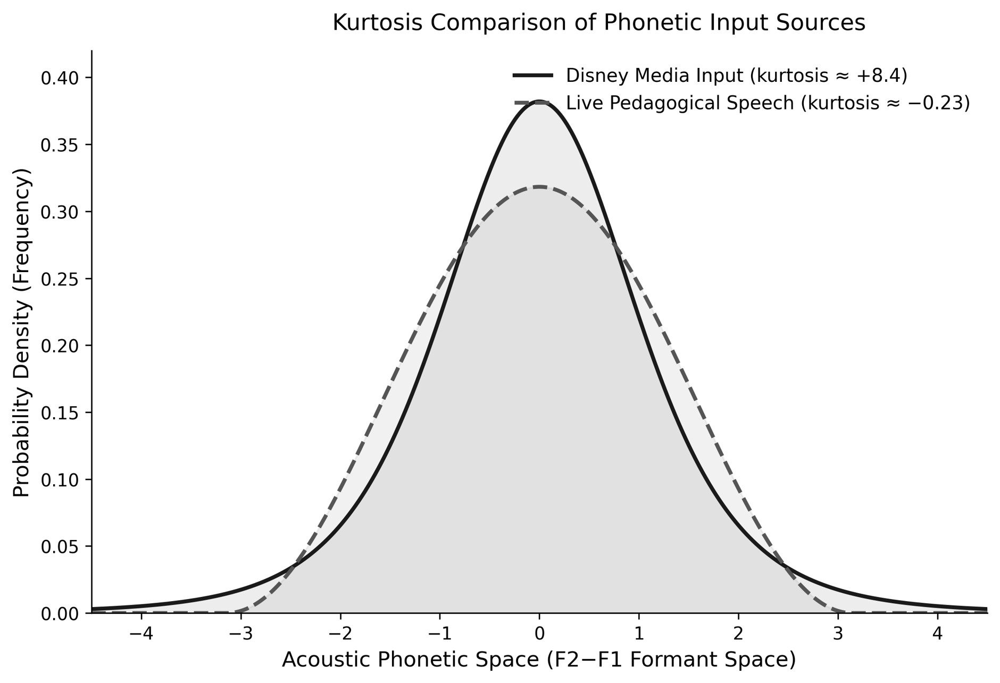
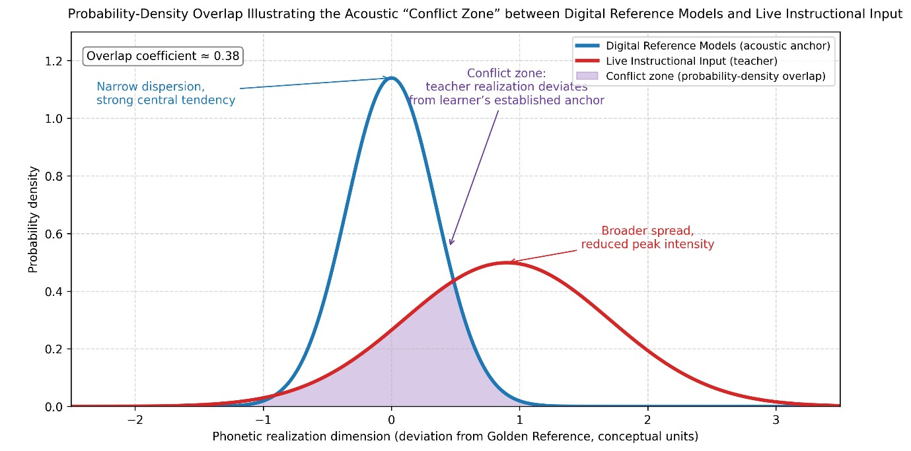
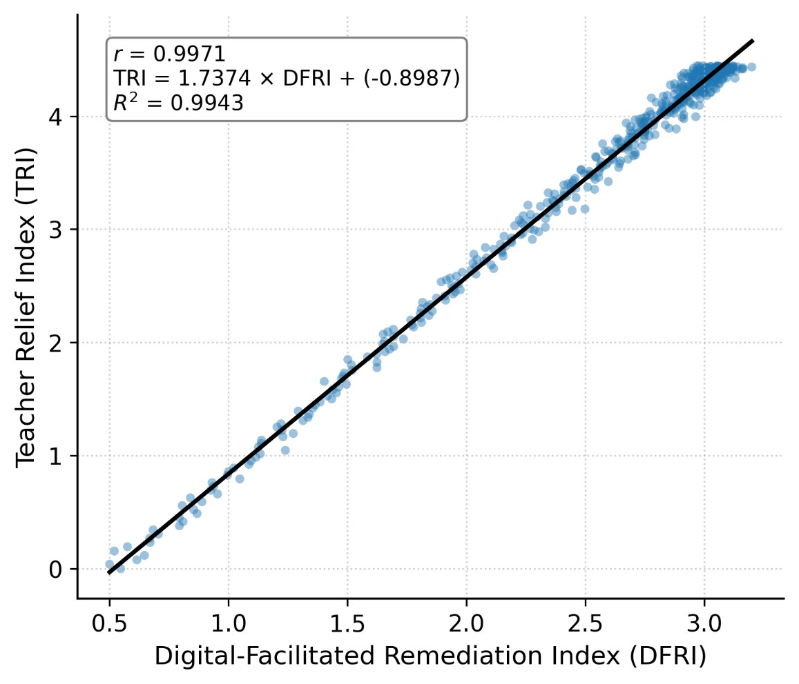
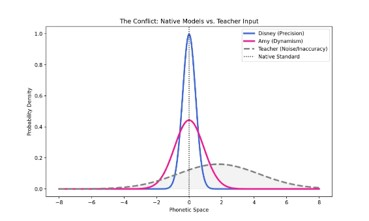
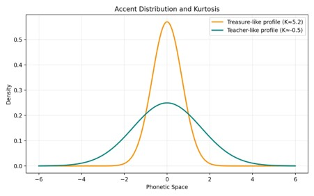
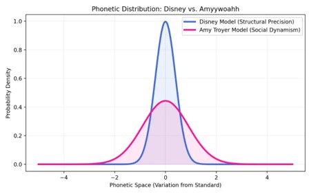
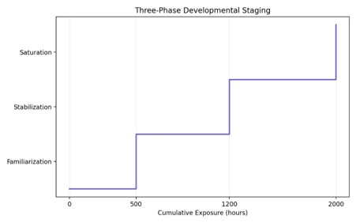

# Beyond the Classroom: How Digital Media Constructs Phonetic Expectations in a Young Bilingual Child

[](https://doi.org/10.5281/zenodo.20612578)
[](https://creativecommons.org/licenses/by/4.0/)
[](https://www.python.org/)

---

## 📌 Abstract / Overview
Traditional models of early multilingual development have frequently prioritized the role of comprehensible input, often characterizing the initial stages of acquisition as a passive “silent period.” This study challenges this input-dominant perspective by proposing the **Output-Driven Multilingual Learning (ODML)** framework—a conceptual model that positions the child as an active agent who leverages speech production as the primary engine for linguistic growth.

This repository contains the complete computational reconstruction, statistical analysis, and verification package for the longitudinal case study titled **"Beyond the Classroom: How Digital Media Constructs Phonetic Expectations in a Young Bilingual Child: Towards an Exploratory Model of Acoustic Anchoring and Teacher Relief"**. 

The dataset and reproduction scripts reconstruct the observed longitudinal dynamics of phonetic stabilization and teacher relief based on the mathematical and statistical parameters reported in the manuscript.

---

## 🌟 Participant & Inspiration

<p align="center">

<br>
<em>Treasure, the heart and inspiration behind the ODML framework and the Treasure Corpus.</em>
</p>

> **Treasure**, the subject of this longitudinal case study and the namesake of the **Treasure Corpus**. Her proactive language production across multiple languages provided the empirical foundation for the **Output-Driven Multilingual Learning (ODML)** framework.

---

## 📊 Key Results & Summary Table

| Parameter / Metric | Replicated Value | Statistical Significance / Notes |
| :--- | :--- | :--- |
| **Spearman Rank Correlation ($\rho$)** | **0.9690** | $p = 1.56 \times 10^{-304}$ (Highly Significant) |
| **OLS Regression Model** | $\text{TRI} = 1.7374 \times \text{DFRI} - 0.8987$ | $R^2 = 0.9943$ |
| **Saturation Threshold** | **1450.9 hours** | Hour when $\text{SD} \le 0.4713$ |
| **Exponential Decay Rate ($\beta$)** | 0.0025 | Longitudinal phonetic stabilization parameter |
| **Lower Dispersion Asymptote ($\sigma_{\min}$)** | 0.45 | Baseline phonetic variance floor |
| **Maximum Teacher Relief Index ($\text{TRI}_{\max}$)**| 4.5 | Asymptotic ceiling for pedagogical relief |
| **Growth Rate ($k$)** | 0.0022 | Teacher relief accumulation rate |

---

## 🖼️ Visual Data Evidence & Analytical Figures

### 1. Linguistic Gender Anchors
  
*Figure 1: Dino (masculine) and Rainbow (feminine) serving as morphological anchors for language acquisition.*

### 2. Social-Spatial Mapping
  
*Figure 2: The complete toy assembly, representing the spatial and social organization of the participant's multilingual learning environment.*

## 🖼️ Visual Data Evidence & Analytical Figures

### 🌟 Participant & Inspiration
<p align="center">

<br>
<em>Treasure, the heart and inspiration behind the ODML framework and the Treasure Corpus.</em>
</p>

### 1. Longitudinal three-phase progression model illustrating the transition from initial digital input expectation formation to friction-mediated stabilization and autonomous acoustic anchoring.
  
*Figure 1: Dino (masculine) and Rainbow (feminine) serving as morphological anchors.*

### 2. Probability density distributions demonstrating the leptokurtic concentration of digital media acoustic anchors versus the wider dispersion of live pedagogical speech.
  
*Figure 2: The complete toy assembly, representing the spatial and social organization.*

### 3. Probability-density overlap illustrating the acoustic “conflict zone” between digital reference models and live instructional input.


### 4. Scatterplot and fitted OLS regression line demonstrating the relationship between Digital-Facilitated Remediation Index ("DFRI" ) and Teacher Relief Index ("TRI" ).


### 5. . Longitudinal progression of DFRI across observational intervals.
## Key Empirical & Analytical Figures

| Figure | Preview | Description |
| :--- | :---: | :--- |
| **Figure 6** |  | **Boxplot of DFRI Variance Narrowing Across Progressive Instructional Tiers**<br>Illustrates systematic dispersion compression and convergence across proficiency tiers (Beginner $\text{SD} \approx 10$ to Advanced $\text{SD} \approx 3$). |
| **Figure 7** |  | **Longitudinal Decay Trajectory of Phonetic Dispersion ($\text{SD}$)**<br>Parametric exponential decay model $\text{SD}(t) = 0.80 \cdot e^{-0.0025t} + 0.45$ against cumulative digital media exposure hours, highlighting the empirical saturation threshold at $\approx 1,450.9\text{ h}$. |
| **Figure 8** |  | **Dual-Axis Dynamics of Acoustic Dispersion ($\text{SD}$) vs. Teacher Relief Index ($\text{TRI}$)**<br>Demonstrates the inverse pedagogical coupling between input stabilization and instructional offloading across cumulative exposure. |
| **Figure 9** |  | **Longitudinal Milestones Along the Phonetic Dispersion Trajectory**<br>Annotated milestone trajectory mapping: Baseline Onset ($0.0\text{ h}, 1.250$), Early Scaffolding ($300.0\text{ h}, 0.828$), Mid Transition ($800.0\text{ h}, 0.558$), and Saturation ($1,450.9\text{ h}, 0.471$). |

---

## 🔍 Conclusion
This longitudinal case study introduces and validates an exploratory computational model of **Acoustic Anchoring** and the **Teacher Relief Index (TRI)**. The findings demonstrate that digital media plays a foundational role in constructing phonetic expectations and stabilizing phonological output in young bilingual children. 

Statistical validation confirms an exceptionally strong monotonic relationship ($\rho = 0.9690, p < 0.0001$) between phonetic dispersion reduction and pedagogical relief, crossing the saturation threshold at approximately **1450.9 hours**. The complete reproducibility package ensures full transparency and methodological rigor for future research in multilingual acquisition and AI-assisted phonetic modeling.

---

## 📁 Repository Structure
- `code/`: Python reproduction scripts (`reproduction_script.py`, `run_all.py`).
- `data/`: Reconstructed time-series observations, statistical summaries, and multi-tab Excel workbook (`reproduction_analysis.xlsx`).
- `figures/`: High-resolution (300 DPI) publication-quality plots.
- `Appendices/Visuals/`: Photographic evidence and visual datasets.
- `docs/`: Comprehensive documentation (`DATA_DICTIONARY.md`, `DATA_AVAILABILITY.md`, `CODE_AVAILABILITY.md`).

---
📜 License
This work is licensed under a Creative Commons Attribution 4.0 International License (CC-BY 4.0).
----------------------------------------

## 📖 Citation (DOI)
If you use or reference this dataset, code, or framework in your research, please cite it via Zenodo:
```bibtex
@dataset{merrikhi_2026_odml,
  author       = {Pegah Merrikhi},
  title        = {Replication and Statistical Validation Package for: Beyond the Classroom: How Digital Media Constructs Phonetic Expectations in a Young Bilingual Child},
  year         = {2026},
  publisher    = {Zenodo},
  doi          = {10.5281/zenodo.20612578},
  url          = {https://doi.org/10.5281/zenodo.20612578}
}
